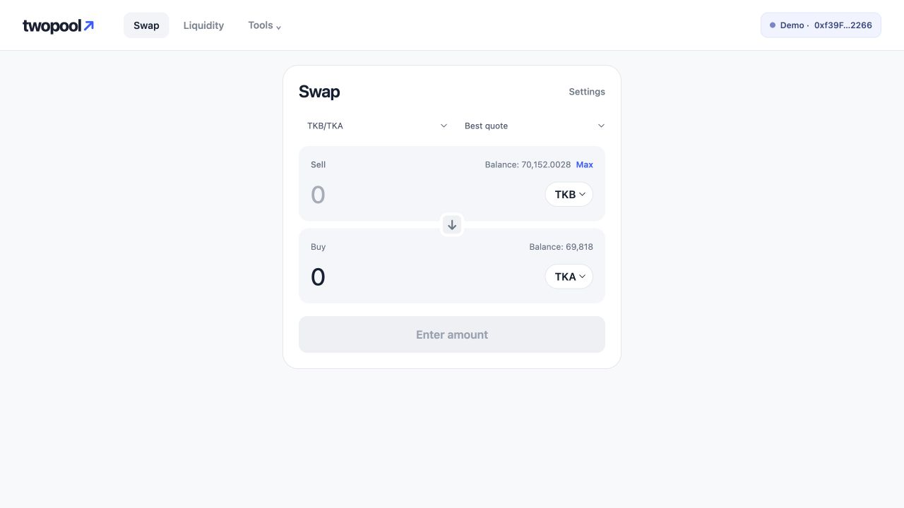
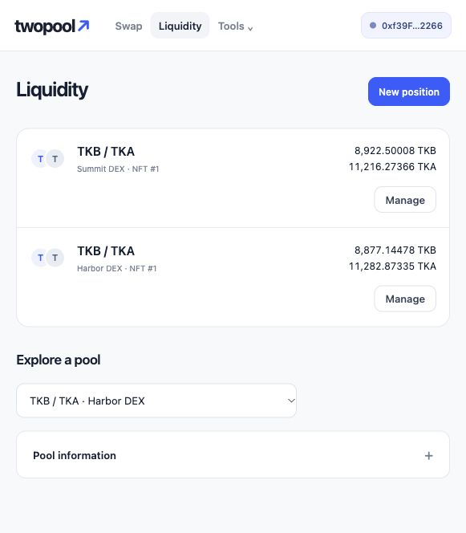
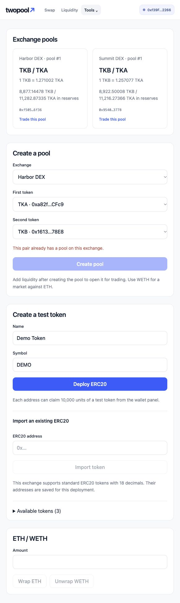
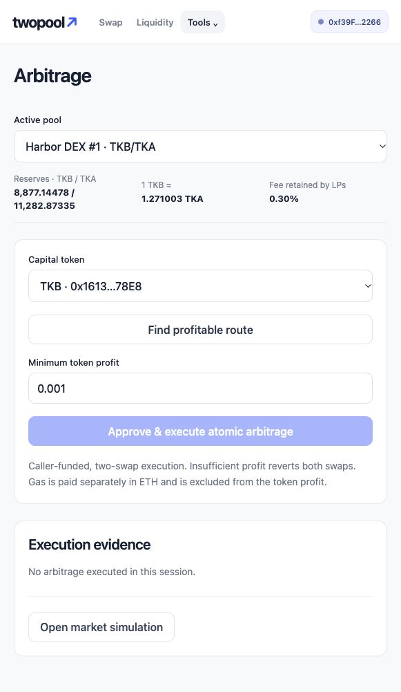
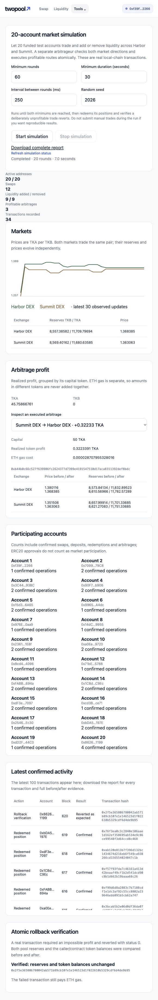
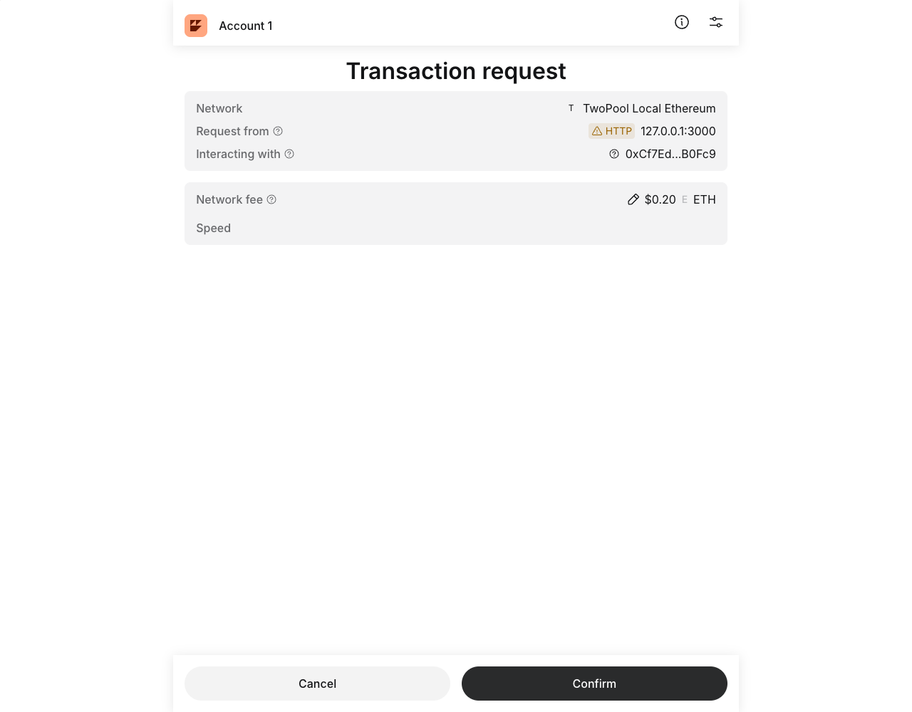

# TwoPool DEX：AMM、NFT 流动性凭证与原子套利

基于以太坊本地链的去中心化交易所课程项目。用户可以领取或创建 ERC20 测试代币、创建交易池、交易、添加流动性并获得 ERC721 NFT，最后销毁 NFT 赎回资产。两个独立交易所 Harbor 和 Summit 为相同代币提供不同的池子；模拟器让 20 个地址持续交易，套利合约在一笔交易中完成两次交换并检查利润。

## 环境与运行

需要 **Node.js 22.13+（22.x）、24.x 或 26+**、npm，以及[形式化工具链](formal/TOOLCHAIN.md)中的 Coq 8.20.1、OCaml、js_of_ocaml 和 rocq-of-solidity。Coq 是 Rocq 改名前的名称；本项目固定 8.20.1，以使用上游已有 Solidity 语义，不自行移植语义。建议使用 Node.js 24。本项目实际验收使用 Node.js 26.5.0。浏览器无需钱包扩展即可通过本地节点的测试账户操作；也支持 MetaMask 等 EIP-1193 浏览器钱包。

在仓库根目录执行：

```bash
npm run setup
npm run formal:bootstrap
npm run dev
```

`npm run dev` 启动本地开发环境。合约 ABI 由实际编译产物生成；前端业务内核由 Rocq 提取并编译为 JavaScript。启动器按需启动本地链、部署合约、启动模拟控制服务和网页。已有的本地链及有效部署会被复用；不会为了启动界面而重置账户或资产。命令会输出网页地址；`Ctrl+C` 只停止本次命令启动的服务。日志位于 `.local/logs/`（不提交仓库）。

如果需要分别运行各个服务，先生成编译产物与前端内核：

```bash
npm run build
```

再在不同终端执行：

```bash
npm --prefix contracts run node
npm --prefix contracts run deploy
npm --prefix contracts run simulation:server
npm --prefix frontend run dev
```

先启动节点，再部署；节点、模拟服务和前端保持运行。

部署自动创建 TKA、TKB、WETH、Harbor、Summit 和 AtomicArbitrage；为节点提供的 20 个账户分别领取 TKA/TKB，并创建两个 10000 TKA / 10000 TKB 的初始池。Hardhat 已为这些账户提供测试 ETH。部署者持有两个初始流动性 NFT。

打开 [http://127.0.0.1:3000](http://127.0.0.1:3000)。首次打开使用本地 RPC 的第一个演示账户，点击顶栏钱包按钮，在 Demo wallet 中切换 20 个账户；余额与领取入口也在钱包窗口内。链 ID 为 `31337`，RPC 为 `http://127.0.0.1:8545`。不要把这些公开测试账户用于真实资产。

刷新网页会保留工作区、所选池及钱包选择。浏览器钱包锁定或网络不匹配时，页面等待恢复连接；刷新通过现有权限恢复账户，不会重新弹出授权。

`shared/deployment.json` 根据实际部署生成，不提交仓库。重新启动节点会清空链状态，必须重新部署并刷新网页。部署可重复执行，但会部署一套新合约并覆盖该文件；先前合约仍在当前链中。

### 使用浏览器钱包

1. 点击右上角钱包按钮，选择 **Connect browser wallet** 并批准连接。
2. 网络不匹配时，在钱包窗口点击 **Add / switch local network**，按钱包提示添加并切到链 `31337`。
3. 新钱包没有资产时，在该窗口点击 **Prepare test assets**。本地节点先转入 ETH，随后钱包分别确认领取 TKA/TKB。
4. 关闭钱包窗口，在兑换卡片输入数量。钱包会在需要时请求精确额度批准，再请求实际交换。
5. 钱包账户变化会同步身份；错误网络下的兑换动作会打开恢复入口，禁止签名交易；切回后恢复。

迁移前的演示版本曾用官方未修改的 MetaMask 13.53.0 与隔离钱包完成连接、加网络、领币、授权和交换，历史收据与余额记录见[迁移前真实钱包演示](docs/wallet-demo.md)。该记录不替代当前提取内核的验证。ETH faucet 由本地开发节点提供，仅用于测试资产。

## 操作流程

- **Swap**：首页直接显示兑换卡。选择交易对、输入卖出数量，默认用 Best quote 比较本部署的直接池，选择实际收到数量最多的池子；也可手动指定成交池。可反转方向、用 Max 填入余额，在 Settings 中调整滑点。点击 **Swap**，按需完成批准与交换。
- **Liquidity**：先查看自己的头寸，点击 **New position** 选择池和投入量，再 Review 后确认铸造 NFT。已有池按当前比例投入，未使用部分留在钱包；新池由首次提供者设定初始比例。
- **持仓管理**：Liquidity 按交易对列出头寸。Manage 中可查看所有权比例、当前双币资产、估值、相对原始存币的价值变化和元数据；价值变化包含费用与无常损失，不是独立的手续费余额。可转让 NFT，或在确认预计/最低收到数量后烧毁赎回；取消不会发交易，转让后由新持有者赎回。
- **Pool information**：按需查看当前提供者、历史添加/撤销、累计交易量和池费用，退出头寸的历史仍保留。
- **Tools → Pools & tokens**：在指定交易所建池；可部署自定义名称/符号的 18 位测试 ERC20，也可导入具有可读标准元数据的其他精度 ERC20。新建测试代币可从钱包面板领取。支持 ETH/WETH 包装与解包，用 WETH 建立代币/ETH 对应的交易池。
- **Tools → Arbitrage**：选定池后点击 **Find profitable route**，选择本金代币，扫描两个方向、1/5/10/25/50/100/200/500 的输入量，并按同一本金币种的利润排序。存在机会时展示本金和预期利润；设置最低利润后一次提交原子套利。结果显示实际利润及两池储备和价格的前后变化。
- **Tools → Token approvals**：查看当前账户的已知代币对本部署交易所及套利合约的剩余授权，选择一项并确认后将额度设为零。已确认的授权不会随取消兑换而消失；撤销也不会撤回过去的转账。读取失败时显示未知，只有链上额度读为零才显示撤销完成。
- **Tools → Transactions**：按 RPC 端点、链和部署隔离保存本浏览器的操作记录，批准与执行分别记录。可按当前账户和交易状态查找，每页显示 20 条；发送者和实际领取者均可查到领取测试币的记录。刷新后继续查询已知哈希的确认状态，不恢复签名权限或重发交易；各标签页的记录互不覆盖。浏览器无法保存时会明确提示仅保留在内存中，兑换和赎回仍可执行。

自定义代币列表按部署地址保存在当前浏览器中，刷新后继续可用。链上的代币、池和 NFT 数据由合约维护。

## 功能与实现分析

### AMM 定价和手续费

每个 MiniDEX 维护多个按地址排序的代币对，同一交易所禁止重复建同一代币对。输入数量为 `dx`，输入储备为 `x`、输出储备为 `y` 时：

```text
amountInWithFee = dx × 9970
amountOut = floor(amountInWithFee × y / (x × 10000 + amountInWithFee))
```

交易收取 0.3% 手续费，全部留在池中，不单独建立奖励账户；流动性提供者通过份额共享增加的储备。价格显示为储备比，实际成交还受手续费和价格冲击影响。

### ERC721 流动性与分红

首次加入的份额基于 `sqrt(amount0 × amount1)`；其中 1000 个最小份额永久锁定，以免池子被完全清空后通过重新初始化影响份额会计。后续按储备比例计算份额。每次添加流动性铸造一个独立 NFT，记录池 ID、份额、初始投入与时间戳；`tokenURI` 返回自包含的 Base64 JSON。

```text
redeem0 = floor(positionShares × reserve0 / totalShares)
redeem1 = floor(positionShares × reserve1 / totalShares)
```

赎回烧毁整个 NFT。手续费已反映在当前储备中，无需另行领取。ERC721 所有者或被授权的操作者可赎回，但资产始终转给当前所有者。NFT 不保证原始两种代币数量：价格变化可能带来无常损失。

### Bonus：双交易所与原子套利

Harbor 和 Summit 是两个独立部署的交易所，具有独立储备。模拟器在两个市场分别执行随机交易，产生价格差，再自动寻找扣除两次交易手续费后的有利路径。

`AtomicArbitrage.execute` 从调用者领取本金，执行 `本金代币 → 中间代币 → 本金代币`，要求最终收回数量大于本金且利润达到 `minProfit`。任何一步失败或利润不足，EVM 回滚整笔交易，包括两池储备、ERC20 余额及该笔交易内的 allowance 变化。提交前单独执行的 approve 不属于套利交易，不会随它回滚；失败交易仍消耗 gas。

这是**自有本金套利**，不使用闪电贷。报价和利润以本金代币计价，**未扣 ETH gas 成本**，不代表法币净利润。界面和模拟器仅扫描有限输入量，不声称找到数学上的最优套利量。合约只支持两交易所之间相同代币对的两跳路径。

### 输入和资产边界

使用 OpenZeppelin 的 ERC20、ERC721、SafeERC20、ReentrancyGuard 和 Math。交易、增减流动性都有期限与最小收到数量检查。代币必须是标准、不重定基准且不收转账税的 ERC20；合约拒绝收到金额不足的入账。前端从链上读取代币精度，支持 `decimals()` 的 uint8 范围；缺少所需元数据时明确拒绝导入，不默认成 18 位。测试 faucet 无限制发币，适用于教学链。

单池每种代币的储备上限为 `2^112−1` 个最小单位，和 Uniswap V2 的储备范围一致；ERC20 余额与 LP 份额仍使用 uint256。这个范围使手续费计算的乘法能建立明确的机器整数边界。有关资产与份额选择见 [ADR 001](docs/adr/001-amm-liquidity-and-local-demo.md)，形式化方法与工具链选择见 [ADR 005](docs/adr/005-rocq-and-solidity-verification.md)。前端使用编译产物生成的 ABI，由 viem 编码和发送调用。

## 网页中的 20 地址模拟

打开 **Tools → Simulation**，设置最少轮数、最短时间、间隔和种子，然后点击 Start simulation。界面实时显示两个市场的价格轨迹、储备、20 个账户的参与情况、已确认操作与逐币套利利润；选中某笔套利可查看前后价格/储备、交易哈希和 gas。

Stop simulation 不会把尚未结束的交易当作取消：它等待当前交易确认，再赎回本轮创建的头寸，最终明确标为 Stopped。完整运行标为 Completed；故障标为 Failed。运行报告可下载，包含实际失败套利的 `status=0` 和储备/余额回滚证据。刷新后可重新进入 Simulation 继续查看当前任务。

控制服务只监听本机，接收有界的固定参数并运行已有模拟器，不接受 shell 命令。dev 与 preview 都代理该服务；网站生产构建本身不能代替本地控制服务。参见 [ADR 004](docs/adr/004-local-simulation-control.md)。

### 命令行与持续运行结果

保持节点运行并完成部署后执行：

```bash
cd contracts
npm run simulate
```

默认使用 20 个地址、60 轮、固定种子 2026。每个地址都会参与交易和流动性操作；随机阶段在两个交易所操作，并自动检测套利。每笔操作等待链上收据，报告包括交易哈希、成功次数、参与地址、套利前后价格/储备/利润，以及一次实际失败套利的回滚证明。

延长至至少 2 分钟的演示：

```bash
SIM_ROUNDS=120 SIM_DURATION_SECONDS=120 SIM_INTERVAL_MS=300 npm run simulate
```

`SIM_ROUNDS` 至少 20；`SIM_SEED` 指定随机种子；`SIM_DURATION_SECONDS` 指定最短运行时间；`SIM_INTERVAL_MS` 控制操作间隔。节点区块时间会影响部分时间戳，但同一初始状态和种子决定操作选择。复现实验时不要在前端同时提交交易，以免报价竞争；行情变化引起的拒绝属于真实失败，不算成功。

2026-10-27，当前版本通过模拟服务的公开 HTTP 入口完成了一次真实本地链验收：**60 轮、20 个活跃地址、78.033 秒**，完成 32 次交易、24 次添加流动性、24 次撤销流动性和 6 次盈利套利。任务最终状态为 `completed`，完整 JSON 报告可下载。验收还包含一笔收据 `status=0` 的真实失败套利；比较前后储备和代币余额，回滚检查通过。这是对该次外部行为的验收，不是完整 EVM 的形式化证明。

另一次任务运行中主动停止，最终状态为 `stopped`；已添加的流动性安全赎回，停止后的报告仍可下载。记录保存在 `.local/simulation-delivery-acceptance.json`，不提交仓库。本次验收直接使用 HTTP 与链上公开入口，没有使用浏览器查错。

完整运行报告位于 `shared/simulation-report.json`，不提交仓库。网页 Simulation 的 Download complete report 可取得当前运行报告。报告记录交易哈希、套利储备与利润、回滚检查结果；具体价格、收益和哈希取决于运行开始时的链状态。本地链哈希不能通过公共区块浏览器查询。后面的截图分别标明当前页面与历史钱包记录。

交易期限使用公开 RPC 的 `pending` 区块时间。`ExchangeClient.transactionTimestamp()` 提供这个外部观测，Rocq 据此构造网页交易的 1200 秒期限；模拟 worker 同样读取 pending 时间，使用 300 秒期限。`latest` 只表示上一已挖区块，浏览器时钟也不代表下一次执行块；最终是否到期由合约按执行块时间检查。

时钟修复后的公开入口验收完成 **20 轮、20 个活跃地址、7.007 秒**，报告可下载，实际失败套利的回滚检查通过。首笔交换的期限比实际执行块时间晚 300 秒；另经公开 SDK 完成交换、添加流动性与赎回，三笔交易的期限均比执行块时间晚 1200 秒。记录保存在 `.local/simulation-clock-acceptance.json`、`.local/swap-clock-acceptance.json` 与 `.local/liquidity-clock-acceptance.json`。这是对时钟接口的运行验收，形式化范围如下文所述。

## 形式化开发与验证

共享规格位于 [`formal/theories/Spec`](formal/theories/Spec)，覆盖原始代币单位、AMM、余额转移、流动性份额与 NFT 所有权、合约调用和失败回滚的抽象行为。前端钱包、异步请求、交易日志、资产目录、表单、模拟控制及交易参数由 Rocq 定义，经过 `Extraction → OCaml → js_of_ocaml` 生成执行代码。React 渲染模型输出，viem 处理钱包、ABI 与 RPC；TypeScript 适配器不再重复金额、滑点、份额或审批判断。交易金额与参数使用精确整数，显示位数不影响实际金额；图表中的近似价格不用作交易参数。

钱包会话与请求都有独立标识；过期响应不能覆盖当前会话。批准与交换是两笔交易，切换账户后旧流程不能继续提交。已确认的交易不会因后续读取失败而改写成失败；发送结果未知时保留“未知”状态，不声称未提交。模拟控制停止的是指定任务，旧页面不能停止后来启动的另一任务。

添加流动性、兑换和套利的 ERC20 授权与业务调用分开确认。业务调用的期限按授权完成后读取的 pending 区块时间计算，等待期间保留已确认的金额、路线、滑点和最低利润。运行 `npm run test:deadlines` 可验证长时间授权后的真实链执行。

| 范围 | 验证连接 | 保证边界 |
| --- | --- | --- |
| 前端业务内核 | Rocq 定理、`coqchk`、直接提取到实际加载的 JavaScript | JSON/OCaml 桥接、React 渲染、viem、钱包和 RPC 遵守接口约定 |
| AMM 报价 | 共享模型、实际 `AMMMath` 的 SMT 检查，以及 `calculate_amount_out_runs`、单池与路由前端的 `Run.t` 连接 | 有效 uint112 储备和正输入下，前端提交报价对应既有 harness 继承的生成纯函数，且状态不变；不覆盖 MiniDEX 储备存储、ABI 或 EVM 字节码 |
| 流动性会计 | 共享模型、实际 `LiquidityAccounting` 的 SMT 检查，以及储备加减和份额增减 helper 的 `Run.t` 证明 | 成功路径的有界储备与份额更新；不覆盖 NFT/储备存储组合、外部代币效果、OpenZeppelin `sqrt` / `mulDiv` 实现或完整 EVM |
| 套利结算 | 实际 `ArbitrageSettlement.checkedProfit` 的 SMT 检查及生成 IR 的 `Run.t` 精化定理 | 结算 helper；外部两次 swap、ERC20 副作用及完整 EVM 回滚不在该精化定理内 |
| WETH 与测试币 faucet | 前端本金/最高 gas 预算、资产能力模型及提取逻辑 | 实际 OpenZeppelin 继承代码的 SMT 检查未闭合；不声称 WETH 或完整 faucet 已获得 EVM 认证 |

`atomic_call_failed_preserves_state` 说明共享模型如何表示失败回滚，**没有因此证明 Solidity、EVM 或钱包实现**。合约公开入口验收另行检查失败交易的真实余额与储备。`rocq-of-solidity` 复用官方生成器和语义；实际 helper 的证明使用 `Run.t`，不用未证明的辅助引理替代目标。合约语义证明使用 `-impredicative-set` 和已核实的内核 Primitive；普通前端证明使用通常的逻辑模式。具体命令、文件和信任边界见[形式化说明](formal/README.md)。

在仓库根目录，准备工具链后执行：

```bash
npm run build
npm run formal:verify
npm test
```

`npm run formal:verify` 运行八项统一检查，包括前端提取构建、三组生产 helper 的 SMT 检查和四组 IR 精化检查。

生成内核与 ABI 不提交仓库。提取构建记录输入哈希、编译器与输出哈希；完整日志和验证报告保存在 `.local/formal/`。Solidity SMT 与 IR 精化分别运行，不能把 JavaScript 构建通过当成 Solidity 证明通过。浏览器场景不作为此次错误发现或形式化结论的依据。既有公开合约入口验收覆盖领取、WETH、建池、NFT 转让和赎回、手续费/滑点/期限、20 地址操作，以及原子套利成功和失败回滚；测试通过只说明该运行覆盖的外部行为。

### 交易记录恢复

```bash
npm run test:history
npm run test:replacements
```

`test:history` 先构建当前程序，再用隔离链、真实 WebStorage 和独立进程验证：未挖出的交易先被新页面实例恢复，再自动跟踪至确认；两个页面的记录互不覆盖；无存储时仍可交易；无哈希的未完成操作保持未知，不自动重发；坏归档原文保留；不同 RPC 端点的记录隔离。验收不使用浏览器，也不改动主服务链状态。

`test:replacements` 验证钱包加速、取消和刷新时的原交易确认。加速会保留原哈希与替换哈希，按相同调用的新收据更新状态；取消或改成其他调用则显示 Replaced，停止原流程的后续交易。刷新仍从已有记录恢复公开观察，不续签、不重发。缺少已保存 sender/nonce 等信息时，不把旧哈希查不到猜成交易失败，也不把替换收据的成功记到原操作上。设计原因见 [ADR 010](docs/adr/010-observe-transaction-replacements.md)，模型及外部接口约定见[确认与恢复说明](formal/TRANSACTION-REPLACEMENTS.md)。

恢复模型的证明通过假设审计。归档只提供历史观测，不提供签名权限；任何无哈希的处理中快照都不表示“未广播”，因为后续存储失败可能使页面转入内存模式继续执行。浏览器接受保存不等于链上备份，清除浏览器数据会删除本地记录。设计原因见 [ADR 006](docs/adr/006-persistent-transaction-history.md)，模型与外部接口边界见[交易历史形式化说明](formal/TRANSACTION-HISTORY.md)，独立验收入口见[公开 SDK 验收](frontend/acceptance/README.md)。

### 交易记录查找

```bash
npm run test:activity
```

账户筛选、状态分组和分页由现有交易内核的 Rocq 投影执行。切换账户或筛选条件回到第一页；收据更新保留当前页，记录不足时调整到有效页。查找不改变原始记录或发起钱包请求。模型、证明及公开接口的边界见[交易记录查找说明](formal/ACTIVITY.md)。

该投影的 15 条证明通过假设审计。独立验收通过公开内核入口建立记录，覆盖完整翻页、状态分组、发送者与领取者、账户切换和掉线、空结果恢复、收据更新后的页码调整，以及归档恢复后的查找。该验收检查提取后的实际 JavaScript，不使用浏览器。

### 授权额度管理

```bash
npm run test:allowances
```

额度观察绑定钱包身份、代币、支出合约和读取区块。切换账户后，旧请求不能覆盖新账户的额度或继续签名。撤销沿用现有交易记录；交易确认后若读取失败，会保留确认记录并等待重新查询，不把未知额度当成零。该功能只查看当前部署的交易所和套利合约，未扫描其他应用的授权。

设计取舍见 [ADR 007](docs/adr/007-explicit-allowance-revocation.md)，模型、公开接口和验证边界见[授权管理说明](formal/ALLOWANCES.md)。

模型的 19 条证明通过假设审计。独立公开 SDK 验收在隔离链上通过 10 个场景，包括有限和无限额度撤销、取消与零额度不发交易、代币返回 `false`、读取故障后的恢复、账户切换和过期响应隔离，并核对其他授权、余额及池储备未被改变。验收不使用浏览器。

### 不同精度的代币

```bash
npm run test:precision
```

导入代币时读取链上的小数位数。金额输入、Max、兑换报价、流动性双币金额、池价格、套利本金和利润、授权额度均使用各自代币的精度；合约仍处理原始整数。多余小数位或超出 uint256 的输入会被拒绝，不会为了提交交易而四舍五入。精确数值保留，极小非零量不会显示成真实零。

默认测试币和 ETH/WETH 为 18 位。旧浏览器记录缺少精度时重新验证，读不到元数据时不会猜测；当前演示链可继续使用，无须重置。设计原因见 [ADR 008](docs/adr/008-token-specific-decimal-units.md)，模型、接口和验证范围见[代币精度说明](formal/TOKEN-PRECISION.md)。

相关共享规格的 104 条证明通过假设审计，当前前端请求与实际 AMM 函数的精化连接以及流动性、套利 helper 精化检查通过。独立公开验收的 9 个真实链场景覆盖 0/6/8/255 位资产、混合精度价格与兑换、NFT 流动性赎回、授权额度和套利；其中一次 6 位本金原子套利实际盈利 `7.691062`。这些结果不扩大前述 EVM、元数据和外部接口的验证边界。

### 多池兑换报价

```bash
npm run test:routing
```

Best quote 在同一交易对的已知直接池中比较给定输入的实际输出，包含池手续费和价格影响，不按储备中间价排序。输入量变化可能改变最佳池。它不搜索多跳路径、不拆单，也不把 gas 折算成输出币种。相同报价按快照中的确定池顺序选择。

手动指定的池不可用时会明确拒绝，不静默改到其他交易所。点击提交后，池、金额、报价及最低收到数量作为同一请求固定；批准期间行情改变不会暗换支出合约。设计原因见 [ADR 009](docs/adr/009-select-swaps-by-executable-quotes.md)，模型、接口和验证边界见[兑换路由说明](formal/SWAP-ROUTING.md)。

新增路由模型的 26 条证明通过假设审计，`routed_swap_quote_matches_contract` 将所选报价连接到实际 AMM helper。独立公开验收的 9 个真实链场景通过，覆盖金额改变最佳池、手动选择、匿名报价、精确 Max、候选过滤、同价规则，以及授权期间固定路由和换钱包后的停止执行。

## 项目运行截图

以下截图来自项目实际运行。兑换图更新为本轮的 Best quote 界面，其余图片保留核心流程的既有运行记录；截图仅展示界面，不作为形式化证明或浏览器错误发现的依据。

### 兑换



### 流动性与 NFT



### 资产与交易池



### 原子套利



### 多用户模拟



### 历史 MetaMask 确认

下面这张图来自形式化迁移前的真实钱包演示，保留为历史操作记录；它不代表当前提取内核或当前字节码的验收。详细历史记录见[迁移前真实钱包演示](docs/wallet-demo.md)。



## 参考资料

- [Uniswap 官方：AMM 与参与方](https://developers.uniswap.org/docs/get-started/concepts/how-uniswap-works)
- [Uniswap 官方：V2/V3/V4 手续费](https://developers.uniswap.org/docs/get-started/concepts/fees)
- [Uniswap V2 Pair 源码](https://github.com/Uniswap/v2-core/blob/master/contracts/UniswapV2Pair.sol)
- [OpenZeppelin ERC20](https://docs.openzeppelin.com/contracts/5.x/erc20)、[ERC721](https://docs.openzeppelin.com/contracts/5.x/erc721)
- [Hardhat 文档](https://hardhat.org/docs)、[viem 文档](https://viem.sh/)
- [Solidity SMTChecker](https://docs.soliditylang.org/en/latest/smtchecker.html)、[rocq-of-solidity](https://github.com/formal-land/rocq-of-solidity)、[Rocq 文档](https://rocq-prover.org/docs)
- [课程参考 Demo](https://github.com/LBruyne/blockchain-course-demos)

本项目借鉴 Uniswap V2 的恒定乘积与份额机制，用 ERC721 替代可互换的 LP Token，未复制 Uniswap V2 的工厂、路由与闪电交换体系。
