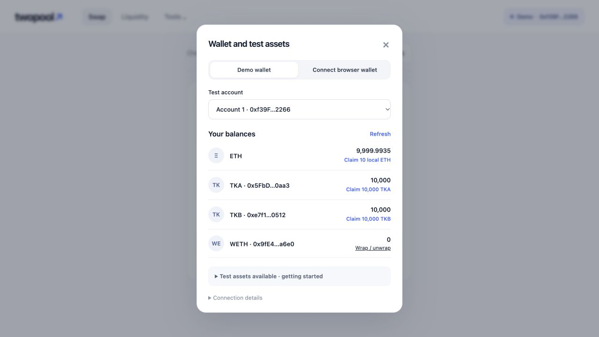
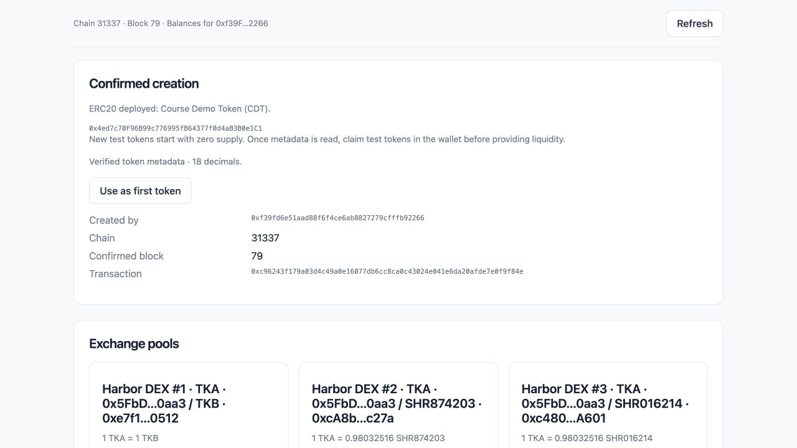
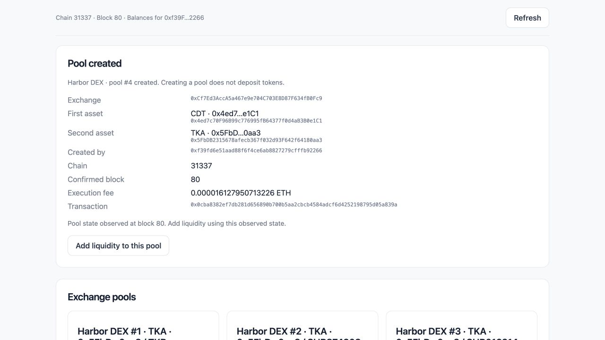
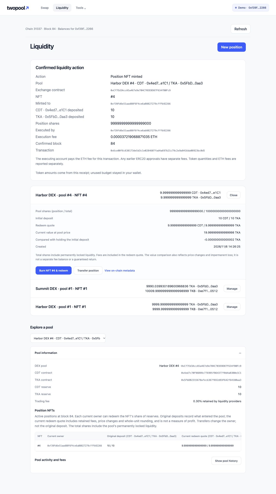
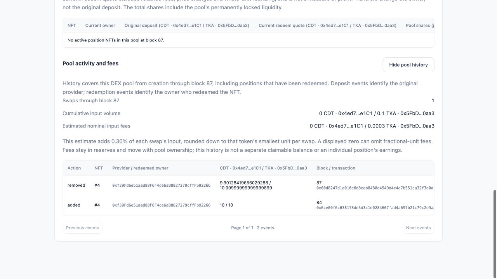
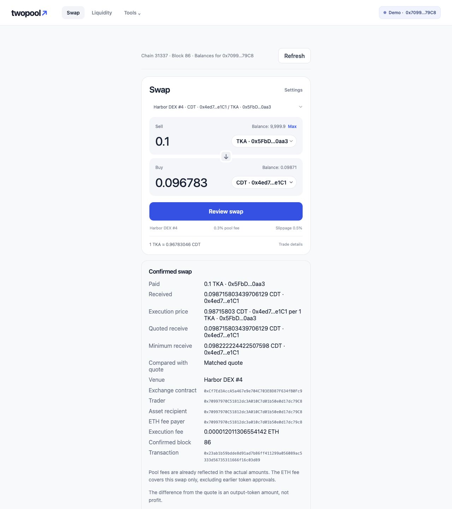
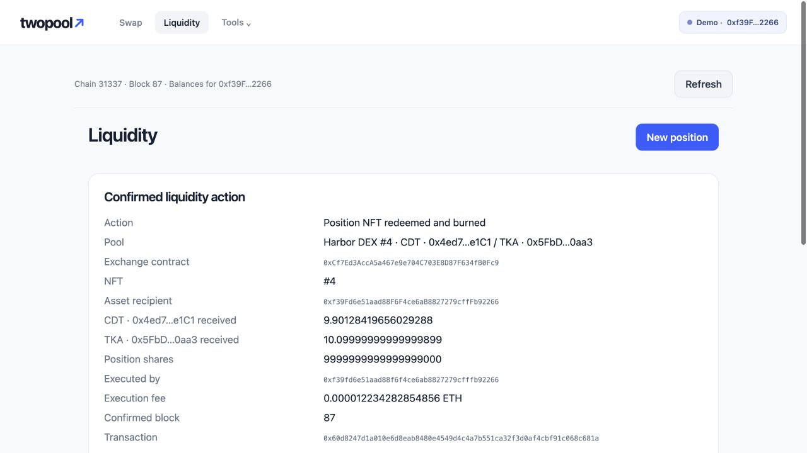
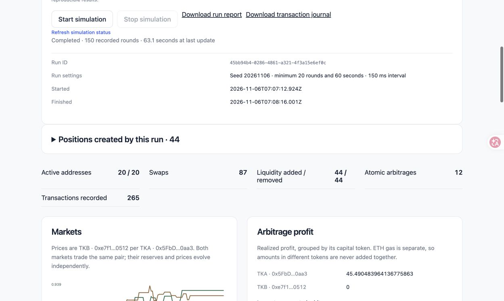
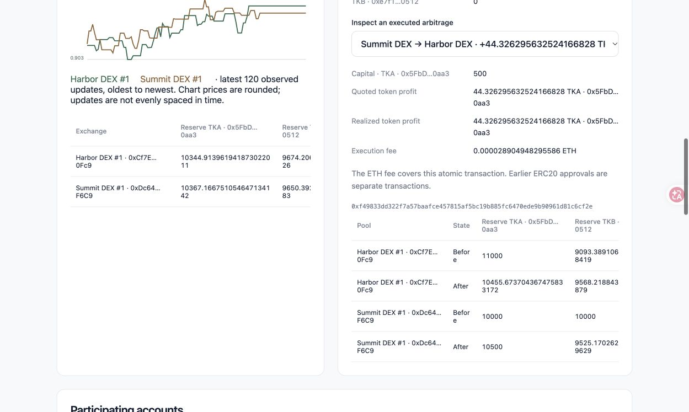
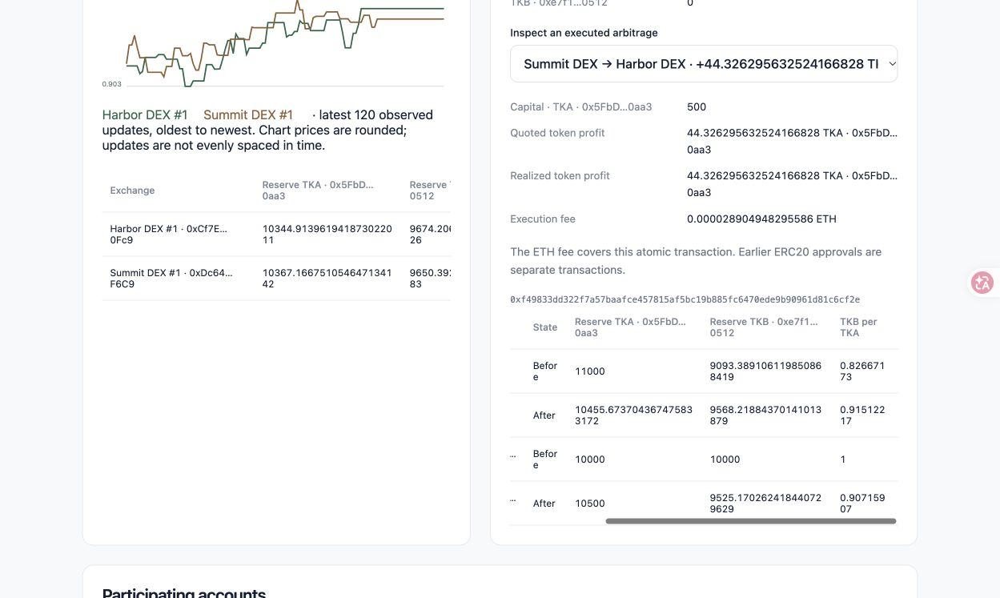

# TwoPool DEX：AMM、NFT 流动性凭证与原子套利

基于以太坊本地链的课程项目。用户可以创建和领取 ERC20 测试代币、创建 AMM 交易池、兑换代币，并通过 ERC721 NFT 提供或撤销流动性。Harbor 与 Summit 是两个独立交易所；20 个模拟用户持续改变两池价格，套利合约在一笔交易中完成买入、卖出及利润检查。

## 环境与运行

需要 Node.js 22.13+（22.x）、24.x 或 26+、npm，以及[形式化工具链](formal/TOOLCHAIN.md)中的 Coq 8.20.1、OCaml、js_of_ocaml 和 rocq-of-solidity。建议使用 Node.js 24。所有资产和账户均用于本地测试链。

在仓库根目录执行：

```bash
npm run setup
npm run formal:bootstrap
npm run dev
```

启动器编译合约、生成 ABI、检查并提取 Rocq 业务内核，按需启动本地链、部署合约、启动模拟服务和网页。已有的本地链与有效部署会被复用；不会为了启动网页而重置资产。打开终端输出的地址，默认是 [http://127.0.0.1:3000](http://127.0.0.1:3000)。

部署创建 TKA、TKB、WETH、Harbor、Summit 和 AtomicArbitrage，为 20 个本地账户领取测试币，并建立两组 10000 TKA / 10000 TKB 的初始池。链 ID 为 `31337`，RPC 为 `http://127.0.0.1:8545`。

`Ctrl+C` 停止本次启动的服务。由启动器创建的 Hardhat 链保存在内存中，退出后链状态会消失。若需在重启网页时保留链状态，可先构建，再分别运行：

```bash
npm run build
npm --prefix contracts run node
# 以下命令在其他终端执行，节点保持运行。
npm --prefix contracts run deploy
npm --prefix contracts run simulation:server
npm --prefix frontend run dev
```

部署信息 `shared/deployment.json`、模拟报告、工具链、日志及编译产物不提交仓库。浏览器测试截图写入 `frontend/test-results/`，临时演示记录放入 `.local/`。

## 操作流程

资产与流动性流程图、模拟与套利结果图来自两次独立的本地部署，均使用同一精简后的应用。

### 1. 选择钱包并领取测试资产

点击右上角钱包按钮。**Demo wallet** 可选择本地节点的 20 个已解锁账户；无需安装扩展。也可用 **Connect browser wallet** 连接 MetaMask 等 EIP-1193 钱包，按 **Add / switch local network** 切到本地链，再用 **Prepare test assets** 领取 ETH 与测试币。

授权、领取和业务交易各自等待真实链上确认。拒签或后续步骤失败不会撤销此前已确认的交易；账户或网络改变后，旧请求不能继续签名。详细步骤见[钱包使用指南](docs/wallet-guide.md)。



### 2. 创建代币和交易池

在 **Tools → Pools & tokens** 创建自定义名称、符号的 18 位测试 ERC20，或导入已有标准 ERC20。新建代币的初始供应量为零，可从钱包领取。列表以合约地址区分资产，并读取真实精度与余额。

选择两种资产和目标交易所后创建池。创建只确定代币对，不注入资金或铸造 NFT；使用 **Add liquidity** 进行首次注资。A/ETH 类池使用 WETH：先将 ETH 按 1:1 包装为 WETH，赎回后可解包为 ETH。





### 3. 添加流动性并查看 NFT 与来源

进入 **Liquidity → New position**，选择池与双币投入量，审阅后确认。首次提供者设定两币比例；已有池按储备比例计算投入，未使用的代币留在钱包。每次添加流动性得到一个 ERC721 NFT，记录交易所、池、份额、初始双币数量和时间。

持仓中可以查看自己的 NFT、当前可赎回数量及元数据。**Pool information** 展示池的流动性来源，包括原始提供者、当前持有人、投入、份额及已赎回记录。NFT 可以转让，由当前持有者赎回。





### 4. 在指定池兑换

在 **Swap** 明确选择 **Active pool**，输入卖出数量。支持 Max、反向兑换和滑点设置；点击 **Review swap** 核对资产地址、池、预计输出和最低收到数量，再 **Confirm swap**。按需先批准代币额度，再执行交换。

成功结果展示实际支付、收到数量、平均成交价、执行费和交易哈希。金额使用代币最小单位计算，不使用浮点数进行交易计算。



### 5. 销毁 NFT 赎回流动性

在头寸的 **Manage** 中审阅预计和最低收到数量，再销毁 NFT。资产转给执行时的 NFT 持有者；确认结果保留实际赎回数量及交易哈希。手续费保留在池储备中，随份额一起赎回，无需另行领取。



### 6. 运行多用户模拟与原子套利

在 **Tools → Simulation** 设置最少轮数、最短运行时间、间隔和种子，点击 **Start simulation**。20 个地址轮流随机兑换、添加和撤销流动性；每笔操作等待真实回执。页面展示两个市场、参与账户、操作数量和逐币利润。

**Stop simulation** 等待当前交易确认，再赎回本轮创建的头寸。完成、主动停止和失败分别显示 `Completed`、`Stopped`、`Failed`。运行报告可下载，包含交易哈希、套利前后储备和实际失败套利的回滚检查。



## 功能和实现分析

### AMM 与手续费

交易使用恒定乘积公式和 0.3% 输入手续费。输入储备为 `x`、输出储备为 `y`、输入量为 `a` 时：

```text
amountOut = floor(997 × a × y / (1000 × x + 997 × a))
```

完整输入进入池储备，手续费留在池中；交易改变储备比例和后续报价。合约检查最小收到数量与期限。只支持普通、无转账税且不 rebasing 的 ERC20，收到数量不符时整笔回滚。

首次流动性的总份额为 `floor(sqrt(amount0 × amount1))`，其中 1000 份永久锁定，其余分给 NFT。后续按储备比例增加份额。赎回数量为 `floor(positionShares × reserve / totalShares)`，因此包含累积手续费，也受价格变化和整数舍入影响；它不保证等于最初存入的两币数量。

### Bonus：双交易所和原子套利

Harbor、Summit 对相同代币对维护独立储备。模拟器在两所随机交易形成价差，自动扫描两个方向，找到扣除两次池手续费后盈利的路线。

`AtomicArbitrage.execute` 用调用者本金执行 `本金代币 → 中间代币 → 本金代币`，两次交换和最低利润检查在同一交易内完成。任一步失败或利润不足，EVM 回滚整笔交易；此前单独确认的 approve 不属于这笔交易。失败交易仍支付 gas。

手动入口位于 **Tools → Arbitrage**，可输入本金并审阅路线。页面及模拟报告展示实际本金、买卖数量、利润和两池前后储备、价格。利润以本金代币计价，ETH 执行费另列，不进行跨币种相减。本项目使用自有本金，不使用闪电贷，也不声称扫描得到全局最优套利量。





2026-11-06，在新的独立本地链通过模拟服务公开入口完成了一次持续运行：种子 `20261106`、最少 20 轮、最短 60 秒、轮间隔 150 ms。最终报告记录：

| 项目 | 实际结果 |
| --- | --- |
| 持续时间 / 实际轮数 | 63.077 秒 / 150 轮 |
| 活跃地址 / 链上回执 | 20 / 265 |
| 兑换 / 添加 / 撤销流动性 | 87 / 44 / 44 |
| 成功原子套利 | 12 次 |
| 代币套利利润 | 45.490483964136775863 TKA；TKB 为 0 |
| 真实失败套利 | 收据状态 `0`，两池储备和代币余额前后相同 |

图中一笔成功套利使用 500 TKA 本金，实际利润为 44.326295632524166828 TKA；两池的 Before/After 对应同一笔原子交易。

<details>
<summary>本轮 20 个参与地址</summary>

```text
0xf39Fd6e51aad88F6F4ce6aB8827279cffFb92266
0x70997970C51812dc3A010C7d01b50e0d17dc79C8
0x3C44CdDdB6a900fa2b585dd299e03d12FA4293BC
0x90F79bf6EB2c4f870365E785982E1f101E93b906
0x15d34AAf54267DB7D7c367839AAf71A00a2C6A65
0x9965507D1a55bcC2695C58ba16FB37d819B0A4dc
0x976EA74026E726554dB657fA54763abd0C3a0aa9
0x14dC79964da2C08b23698B3D3cc7Ca32193d9955
0x23618e81E3f5cdF7f54C3d65f7FBc0aBf5B21E8f
0xa0Ee7A142d267C1f36714E4a8F75612F20a79720
0xBcd4042DE499D14e55001CcbB24a551F3b954096
0x71bE63f3384f5fb98995898A86B02Fb2426c5788
0xFABB0ac9d68B0B445fB7357272Ff202C5651694a
0x1CBd3b2770909D4e10f157cABC84C7264073C9Ec
0xdF3e18d64BC6A983f673Ab319CCaE4f1a57C7097
0xcd3B766CCDd6AE721141F452C550Ca635964ce71
0x2546BcD3c84621e976D8185a91A922aE77ECEc30
0xbDA5747bFD65F08deb54cb465eB87D40e51B197E
0xdD2FD4581271e230360230F9337D5c0430Bf44C0
0x8626f6940E2eb28930eFb4CeF49B2d1F2C9C1199
```

</details>

结果来自该次运行的真实交易、事件和回执；具体收益随初始链状态和操作顺序变化。ETH gas 单独记录，不计入上述代币利润。完整运行报告由网页下载，开发记录留在忽略的 `.local/` 中。


## 形式化开发与验证

按 Solidity + Rocq 方法开发：Solidity 和 OpenZeppelin 实现链上合约；Rocq 定义共享规格、前端业务状态及决策，并通过 `Extraction → OCaml → js_of_ocaml` 生成 JavaScript。React 渲染界面，viem 处理钱包、RPC 和 ABI，不在 TypeScript 中复制业务判断。

形式化检查覆盖报价、整数边界、份额、参数构造、钱包身份、异步状态和部分合约 helper 的精化。实际 Solidity 的 SMT 检查、翻译一致性、Rocq 证明与前端提取分别记录结果；前端构建成功不表示完整 Solidity/EVM 已被证明。详细命令及证明边界见[形式化说明](formal/README.md)。

```bash
npm test
npm run formal:verify
npm run test:asset-setup
npm run test:precision
npm run test:deadlines
npm run test:liquidity-evidence
npm run test:simulation
npm run test:arbitrage-evidence
npm run test:pending
```

公开入口验收使用隔离链，不重置演示链。浏览器验收命令见[前端说明](frontend/README.md)。当前活动页面保留本页交易状态；同一标签页刷新后可继续观察已知待确认交易，不续签或重发。已完成交易不再长期归档，也不提供通用历史业务结果重读。

## 参考资料

- [Uniswap V2：流动性](https://developers.uniswap.org/docs/protocols/v2/guides/providing-liquidity)、[交易集成](https://developers.uniswap.org/docs/protocols/v2/guides/swapping)
- [Uniswap V2 Pair 源码](https://github.com/Uniswap/v2-core/blob/master/contracts/UniswapV2Pair.sol)
- [OpenZeppelin ERC20](https://docs.openzeppelin.com/contracts/5.x/erc20)、[ERC721](https://docs.openzeppelin.com/contracts/5.x/erc721)
- [Solidity SMTChecker](https://docs.soliditylang.org/en/latest/smtchecker.html)、[rocq-of-solidity](https://github.com/formal-land/rocq-of-solidity)、[Rocq](https://rocq-prover.org/)
