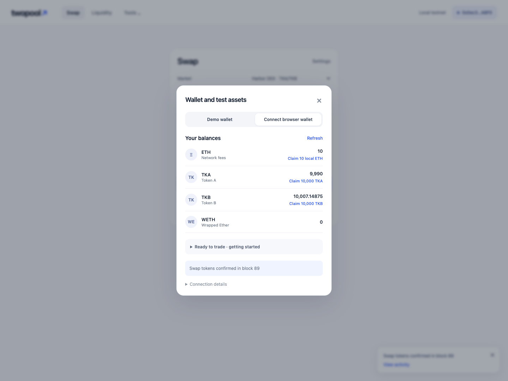
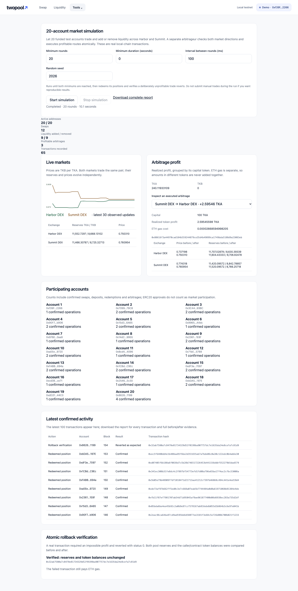
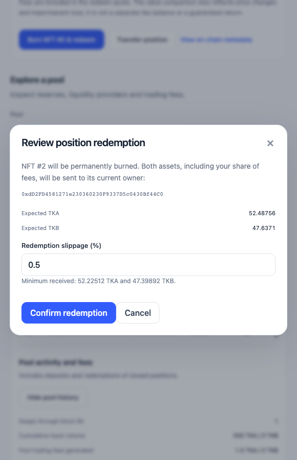

# TwoPool DEX：AMM、NFT 流动性凭证与原子套利

基于以太坊本地链的去中心化交易所课程项目。用户可以领取或创建 ERC20 测试代币、创建交易池、交易、添加流动性并获得 ERC721 NFT，最后销毁 NFT 赎回资产。两个独立交易所 Harbor 和 Summit 为相同代币提供不同的池子；模拟器让 20 个地址持续交易，套利合约在一笔交易中完成两次交换并检查利润。

## 环境与运行

需要 **Node.js 22.13+（22.x）、24.x 或 26+** 和 npm。建议使用 Node.js 24。本项目实际验收使用 Node.js 26.5.0。浏览器无需钱包扩展即可通过本地节点的测试账户操作；也支持 MetaMask 等 EIP-1193 浏览器钱包。

在仓库根目录执行：

```bash
npm run setup
npm run dev
```

`npm run dev` 编译合约并生成前端类型，按需启动本地链、部署合约、启动模拟控制服务和网页。已有的本地链及有效部署会被复用；不会为了启动界面而重置账户或资产。命令会输出网页地址；`Ctrl+C` 只停止本次命令启动的服务。日志位于 `.local/logs/`（不提交仓库）。

如果需要分别运行各个服务，可在不同终端执行：

```bash
npm --prefix contracts run node
npm --prefix contracts run deploy
npm --prefix contracts run simulation:server
npm --prefix frontend run dev
```

先启动节点，再部署；节点、模拟服务和前端保持运行。

部署自动创建 TKA、TKB、WETH、Harbor、Summit 和 AtomicArbitrage；为节点提供的 20 个账户分别领取 TKA/TKB，并创建两个 10000 TKA / 10000 TKB 的初始池。Hardhat 已为这些账户提供测试 ETH。部署者持有两个初始流动性 NFT。

打开 [http://127.0.0.1:3000](http://127.0.0.1:3000)。首次打开使用本地 RPC 的第一个演示账户，点击顶栏钱包按钮，在 Demo wallet 中切换 20 个账户；余额与领取入口也在钱包窗口内。链 ID 为 `31337`，RPC 为 `http://127.0.0.1:8545`。不要把这些公开测试账户用于真实资产。

刷新网页会保留工作区、所选池及钱包选择。浏览器钱包锁定或网络不匹配时，页面等待恢复连接；刷新通过现有权限恢复账户，不会重新弹出授权。

`shared/deployment.json` 根据实际部署生成，不提交仓库。重新启动节点会清空链状态，必须重新部署并刷新网页。部署可重复执行，但会部署一套新合约并覆盖该文件；先前合约仍在当前链中。

### 使用浏览器钱包

1. 点击右上角钱包按钮，选择 **Connect browser wallet** 并批准连接。
2. 网络不匹配时，在钱包窗口点击 **Add / switch local network**，按钱包提示添加并切到链 `31337`。
3. 新钱包没有资产时，在该窗口点击 **Prepare test assets**。本地节点先转入 ETH，随后钱包分别确认领取 TKA/TKB。
4. 关闭钱包窗口，在兑换卡片输入数量。钱包会在需要时请求精确额度批准，再请求实际交换。
5. 钱包账户变化会同步身份；错误网络下的兑换动作会打开恢复入口，禁止签名交易；切回后恢复。

已用官方未修改的 MetaMask 13.53.0 和全新隔离钱包完成连接、加网络、领币、授权和交换，收据与余额核对见 [真实钱包演示](docs/wallet-demo.md)。自动化故障测试另使用 EIP-1193 适配器，二者分别记录。ETH faucet 由本地开发节点提供，仅用于测试资产。

## 操作流程

- **Swap**：首页直接显示兑换卡。选择市场、输入卖出数量，查看买入报价；可反转方向、用 Max 填入余额，在 Settings 中调整滑点。点击 **Swap**，按需完成批准与交换。
- **Liquidity**：先查看自己的头寸，点击 **New position** 选择池和投入量，再 Review 后确认铸造 NFT。已有池按当前比例投入，未使用部分留在钱包；新池由首次提供者设定初始比例。
- **持仓管理**：Liquidity 按交易对列出头寸。Manage 中可查看所有权比例、当前双币资产、估值、相对原始存币的价值变化和元数据；价值变化包含费用与无常损失，不是独立的手续费余额。可转让 NFT，或在确认预计/最低收到数量后烧毁赎回；取消不会发交易，转让后由新持有者赎回。
- **Pool information**：按需查看当前提供者、历史添加/撤销、累计交易量和池费用，退出头寸的历史仍保留。
- **Tools → Pools & tokens**：在指定交易所建池；可部署自定义名称/符号的测试 ERC20，也可导入已有的 18 位精度标准 ERC20 地址。新建测试代币可从钱包面板领取。支持 ETH/WETH 包装与解包，用 WETH 建立代币/ETH 对应的交易池。
- **Tools → Arbitrage**：选定池后点击 **Find profitable route**，选择本金代币，扫描两个方向、1/5/10/25/50/100/200/500 的输入量，并按同一本金币种的利润排序。存在机会时展示本金和预期利润；设置最低利润后一次提交原子套利。结果显示实际利润及两池储备和价格的前后变化。
- **Tools → Transactions**：显示当前浏览器会话中的交易哈希、区块、操作和 gas 成本，批准与执行分别记录。

自定义代币列表按部署地址保存在当前浏览器中，刷新后继续可用。链上的代币、池和 NFT 数据由合约维护。

## 功能与实现分析

### AMM 定价和手续费

每个 MiniDEX 维护多个按地址排序的代币对，同一交易所禁止重复建同一代币对。输入数量为 `dx`，输入储备为 `x`、输出储备为 `y` 时：

```text
amountInWithFee = dx × 9970
amountOut = floor(amountInWithFee × y / (x × 10000 + amountInWithFee))
```

交易收取 0.3% 手续费，全部留在池中，不单独建立奖励账户；流动性提供者通过份额共享增加的储备。价格显示为储备比，实际成交还受手续费和价格冲击影响。

### ERC721 流动性与分红

首次加入的份额基于 `sqrt(amount0 × amount1)`；其中 1000 个最小份额永久锁定，以免池子被完全清空后通过重新初始化影响份额会计。后续按储备比例计算份额。每次添加流动性铸造一个独立 NFT，记录池 ID、份额、初始投入与时间戳；`tokenURI` 返回自包含的 Base64 JSON。

```text
redeem0 = floor(positionShares × reserve0 / totalShares)
redeem1 = floor(positionShares × reserve1 / totalShares)
```

赎回烧毁整个 NFT。手续费已反映在当前储备中，无需另行领取。ERC721 所有者或被授权的操作者可赎回，但资产始终转给当前所有者。NFT 不保证原始两种代币数量：价格变化可能带来无常损失。

### Bonus：双交易所与原子套利

Harbor 和 Summit 是两个独立部署的交易所，具有独立储备。模拟器在两个市场分别执行随机交易，产生价格差，再自动寻找扣除两次交易手续费后的有利路径。

`AtomicArbitrage.execute` 从调用者领取本金，执行 `本金代币 → 中间代币 → 本金代币`，要求最终收回数量大于本金且利润达到 `minProfit`。任何一步失败或利润不足，EVM 回滚整笔交易，包括两池储备、ERC20 余额及该笔交易内的 allowance 变化。提交前单独执行的 approve 不属于套利交易，不会随它回滚；失败交易仍消耗 gas。

这是**自有本金套利**，不使用闪电贷。报价和利润以本金代币计价，**未扣 ETH gas 成本**，不代表法币净利润。界面和模拟器仅扫描有限输入量，不声称找到数学上的最优套利量。合约只支持两交易所之间相同代币对的两跳路径。

### 输入和资产边界

使用 OpenZeppelin 的 ERC20、ERC721、SafeERC20、ReentrancyGuard 和 Math。交易、增减流动性都有期限与最小收到数量检查。代币必须是标准、不重定基准且不收转账税的 ERC20；合约拒绝收到金额不足的入账。前端仅支持 18 位精度代币。测试 faucet 无限制发币，适用于教学链。

有关选择这些边界的原因见 [ADR 001](docs/adr/001-amm-liquidity-and-local-demo.md)。前端直接使用合约编译生成的 TypeChain 工厂和类型，公开接口以 [Solidity 合约](contracts/contracts/MiniDEX.sol) 为准。

## 网页中的 20 地址模拟

打开 **Tools → Simulation**，设置最少轮数、最短时间、间隔和种子，然后点击 Start simulation。界面实时显示两个市场的价格轨迹、储备、20 个账户的参与情况、已确认操作与逐币套利利润；选中某笔套利可查看前后价格/储备、交易哈希和 gas。

Stop simulation 不会把尚未结束的交易当作取消：它等待当前交易确认，再赎回本轮创建的头寸，最终明确标为 Stopped。完整运行标为 Completed；故障标为 Failed。运行报告可下载，包含实际失败套利的 `status=0` 和储备/余额回滚证据。刷新后可重新进入 Simulation 继续查看当前任务。

控制服务只监听本机，接收有界的固定参数并运行已有模拟器，不接受 shell 命令。dev 与 preview 都代理该服务；网站生产构建本身不能代替本地控制服务。参见 [ADR 004](docs/adr/004-local-simulation-control.md)。

### 命令行与持续运行结果

保持节点运行并完成部署后执行：

```bash
cd contracts
npm run simulate
```

默认使用 20 个地址、60 轮、固定种子 2026。每个地址都会参与交易和流动性操作；随机阶段在两个交易所操作，并自动检测套利。每笔操作等待链上收据，报告包括交易哈希、成功次数、参与地址、套利前后价格/储备/利润，以及一次实际失败套利的回滚证明。

延长至至少 2 分钟的演示：

```bash
SIM_ROUNDS=120 SIM_DURATION_SECONDS=120 SIM_INTERVAL_MS=300 npm run simulate
```

`SIM_ROUNDS` 至少 20；`SIM_SEED` 指定随机种子；`SIM_DURATION_SECONDS` 指定最短运行时间；`SIM_INTERVAL_MS` 控制操作间隔。节点区块时间会影响部分时间戳，但同一初始状态和种子决定操作选择。复现实验时不要在前端同时提交交易，以免报价竞争；行情变化引起的拒绝属于真实失败，不算成功。

另一次连续运行持续 **123.072 秒**，实际执行 **231 轮**，20 个地址参与，完成 113 次交易、75 次添加、75 次撤销流动性及 16 次盈利套利。记录的 302 笔交易中有 301 笔成功、1 笔预期失败；失败交易的储备和余额回滚检查通过。

完整运行报告位于 `shared/simulation-report.json`，不提交仓库。网页 Simulation 的 Download complete report 可取得当前运行报告。

本次真实本地链验收运行 60 轮，耗时约 15.6 秒：20 个活跃地址，32 次交易、24 次添加流动性、24 次撤销流动性、7 次盈利原子套利，记录 88 笔交易（含批准和一笔预期失败交易）。这是运行现场快照，运行前已有试跑交易，重新部署后具体价格和收益会不同。

一个可核对的套利实例：投入 500 TKA，经 Summit → Harbor 返回约 545.49436182 TKA，利润约 **45.49436182 TKA**，未扣 gas。Harbor 的 TKB/TKA 储备价格由 0.6579700664 变为 0.7202823420，Summit 由 0.7889808589 变为 0.7234178470。交易哈希：

```text
0x3c9c406af5ffb385f29f4036b085753c5fd4bcb6b8511c4150c1a2a39ff2d12a
```

最低利润条件不满足的实际失败交易 `0x590ab3f7fcabbed35bbb54ab3351b8026203ee74a096eee76337f8d3f185c3b7` 的收据为 `status=0`。脚本比较交易前后数据，确认两池储备、调用者和套利合约的代币余额均完整回滚。上述哈希只属于本次本地链，不能通过公共区块浏览器查询。

## 验证

合约端到端测试通过公开合约部署和交易入口验证工程目标；测试作者未读取具体合约实现。

```bash
cd contracts
npm run typecheck
npm test
```

5 个场景覆盖：领取 ERC20、包装 ETH 和创建唯一池；NFT 元数据、比例投入与转让后赎回；手续费、滑点和期限；20 地址领取/交易/增减流动性；成功原子套利及失败后的储备/余额/allowance 回滚。

前端以 React 功能页面组织表单，链访问集中在 `frontend/src/chain/client.ts`，使用生成的合约类型而非动态 `any` 调用。钱包会话将地址和 signer 绑定，响应 EIP-1193 事件；TanStack Query 管理链上快照和报价。交易日志分别记录等待签名、已提交、已确认和失败，读取失败不会覆盖已经确认的结果。选择这些边界的原因见 [ADR 002](docs/adr/002-frontend-wallet-and-transactions.md)。

前端构建与真实浏览器流程：

```bash
cd frontend
npm run build
npx playwright install chromium
# 保持本地节点、部署与 npm run dev 在运行
npm test
```

浏览器端到端场景覆盖：完整流程执行领取、交易、增减流动性、创建 ERC20、建池、WETH 包装/解包和界面套利；另外验证无效金额不签名、账户事件与真实交易身份一致、刷新后的身份与链上发送账户一致、错误网络阻断和恢复、拒绝交换后保留批准并可重试、批准期间切换账户时阻止旧 signer、确认后读取失败仍保留成功记录。钱包事件与拒绝签名测试使用 EIP-1193 适配器连接真实本地 RPC，未使用真实钱包扩展。测试会改变当前链状态并更新截图；请勿与模拟器并发执行。验收覆盖本地链，不包含公共测试网或生产部署。

## 项目运行截图

以下截图来自真实本地链与浏览器操作，包含当前账户、链 ID、余额、链上交易确认、NFT 信息和套利结果。

### 领取与交易


### NFT 流动性与来源


### 代币创建、建池与 WETH


### 原子套利结果


### 区块链交互记录


### 钱包与新账户准备



### 网页多用户模拟



### NFT 赎回确认



### 真实 MetaMask 确认


## 参考资料

- [Uniswap 官方：AMM 与参与方](https://developers.uniswap.org/docs/get-started/concepts/how-uniswap-works)
- [Uniswap 官方：V2/V3/V4 手续费](https://developers.uniswap.org/docs/get-started/concepts/fees)
- [Uniswap V2 Pair 源码](https://github.com/Uniswap/v2-core/blob/master/contracts/UniswapV2Pair.sol)
- [OpenZeppelin ERC20](https://docs.openzeppelin.com/contracts/5.x/erc20)、[ERC721](https://docs.openzeppelin.com/contracts/5.x/erc721)
- [Hardhat 文档](https://hardhat.org/docs)、[ethers v6 文档](https://docs.ethers.org/v6/)
- [课程参考 Demo](https://github.com/LBruyne/blockchain-course-demos)

本项目借鉴 Uniswap V2 的恒定乘积与份额机制，用 ERC721 替代可互换的 LP Token，未复制 Uniswap V2 的工厂、路由与闪电交换体系。
