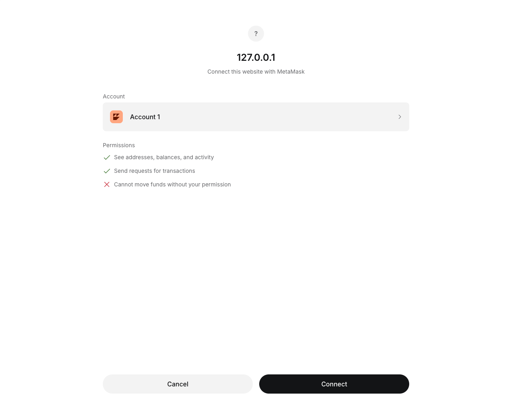
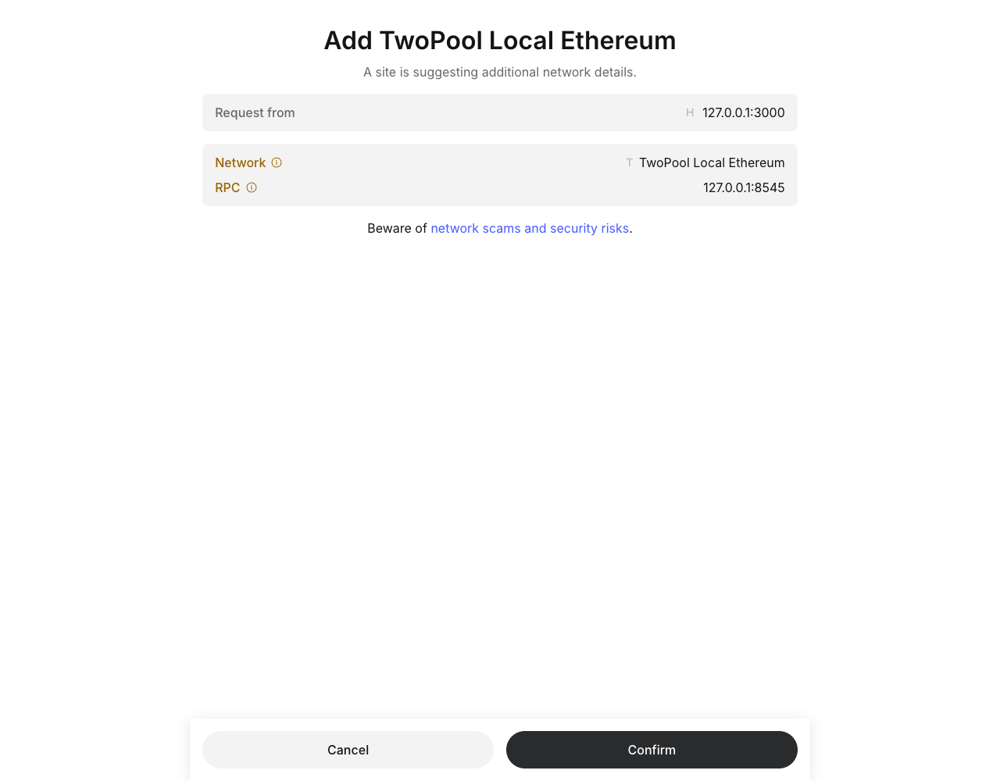
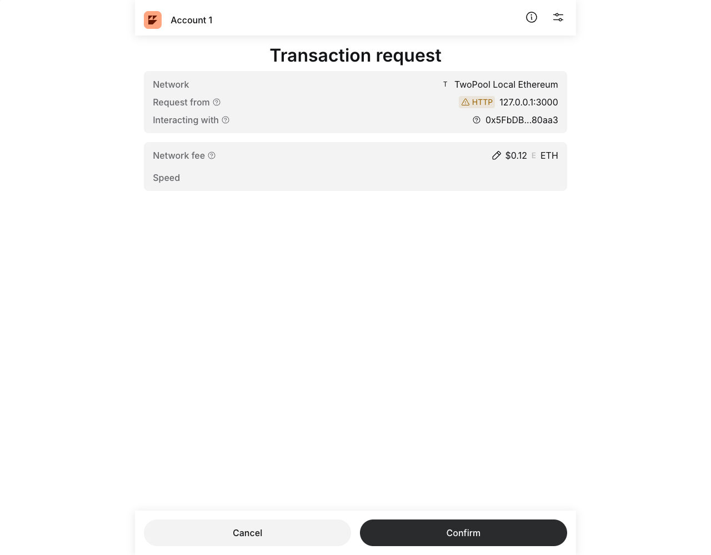
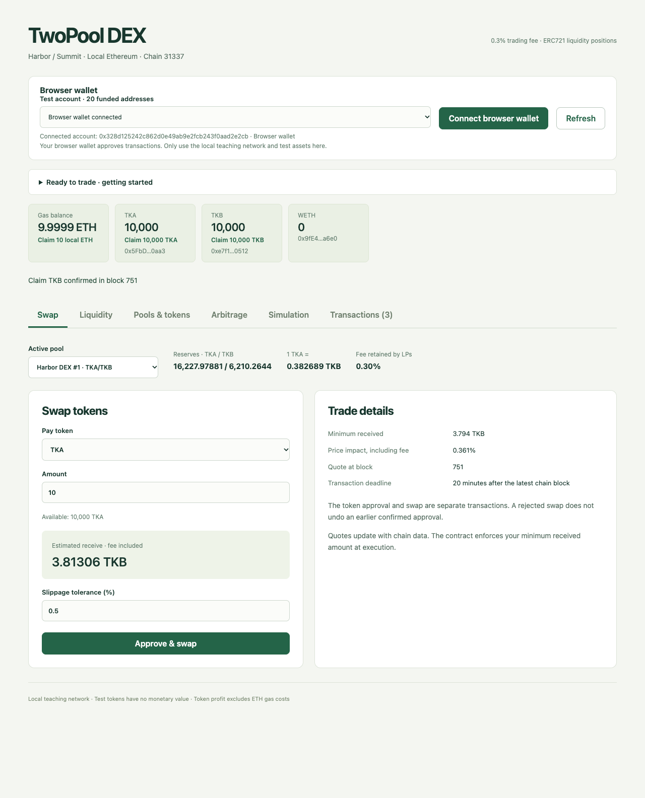
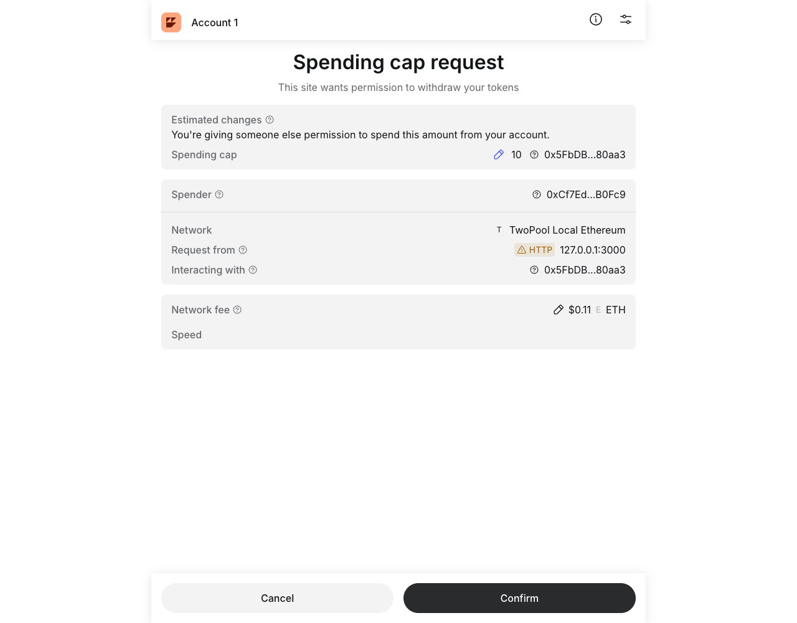
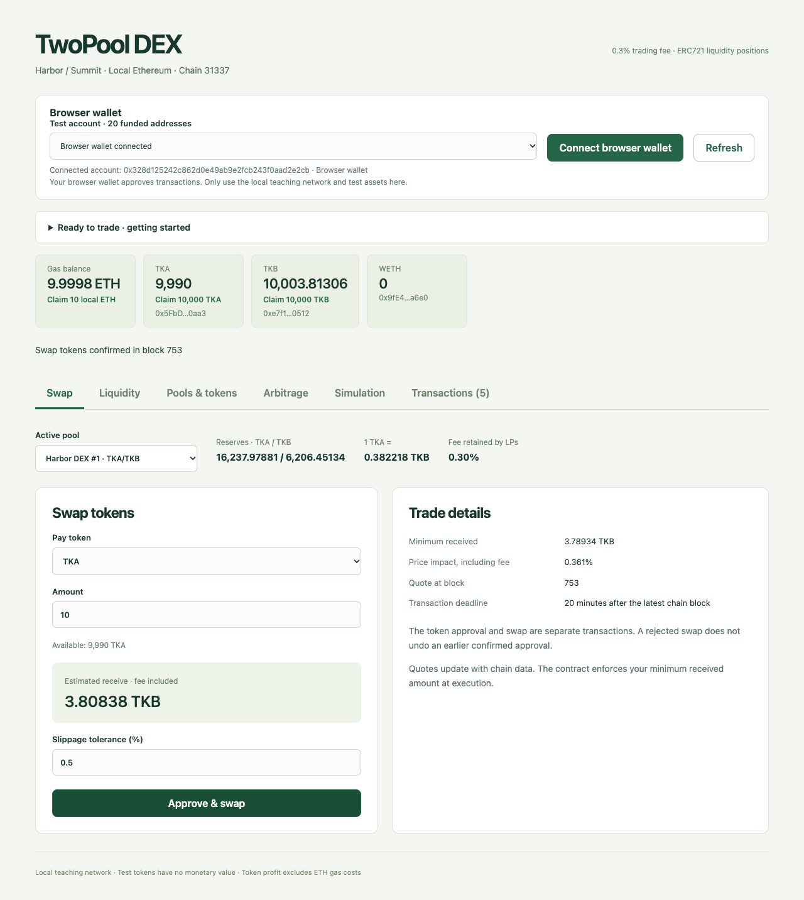
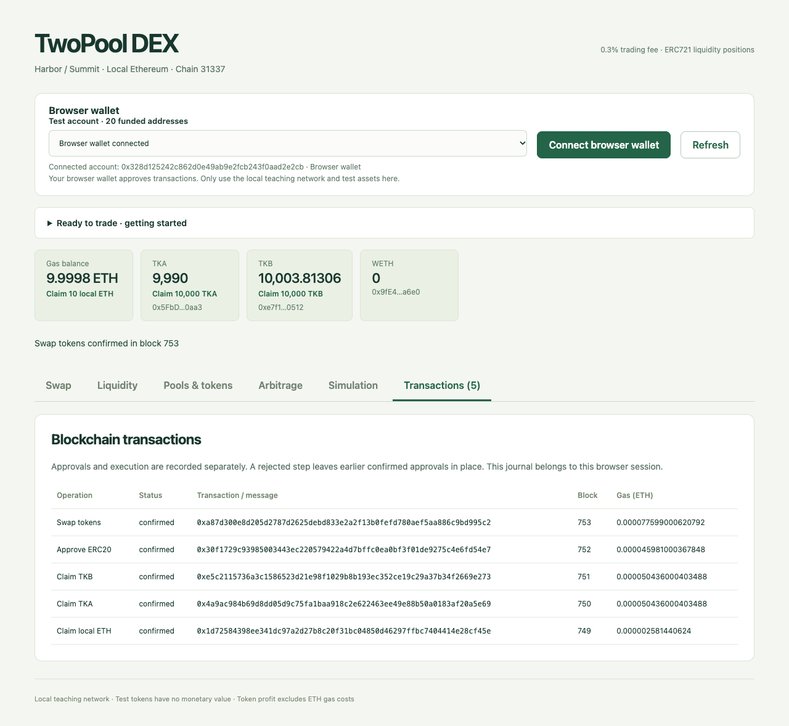

# Real MetaMask demonstration

This workflow was executed with the unmodified official **MetaMask 13.53.0** Chrome extension, loaded into an isolated Playwright Chromium profile. A new wallet was created for this demonstration. No existing browser wallet or development private key was imported. This is a real extension workflow, separate from the EIP-1193 adapters used by automated failure tests.

## Repeat the workflow

Start the local chain, deploy the contracts and run the frontend as described in the [project README](../README.md).

1. Install MetaMask from the [official release](https://github.com/MetaMask/metamask-extension/releases/tag/v13.53.0) or the official browser store link provided by MetaMask. Create a separate test wallet.
2. Open `http://127.0.0.1:3000` and select **Connect browser wallet**. Check the origin and approve the connection in MetaMask.
3. If the wallet is on another network, select **Add / switch local network**. Review chain ID `31337` and RPC `http://127.0.0.1:8545`, then confirm the MetaMask request.
4. Select **Prepare test assets**. The local development account first transfers test ETH to the wallet, so a new wallet can pay for its first transaction. Confirm the TKA and TKB faucet calls in MetaMask. No development private key needs to be imported.
5. In **Swap**, choose the TKA/TKB pool and enter `10` TKA. Review the expected and minimum received amounts, then select **Approve & swap**.
6. MetaMask first requests a spending cap of exactly `10` TKA for the exchange. Review the token, spender and local network, then confirm.
7. MetaMask then requests the swap transaction. Confirm it, wait for the block confirmation, and inspect the new balances and **Transactions** journal.

MetaMask's displayed fiat estimate for gas does not give local ETH a monetary value. Use the receipt's native ETH fee for reproducible gas accounting. Restarting the local node clears its chain; redeploy and refresh the site before repeating the workflow.

## Observed on-chain result

| Field | Verified value |
| --- | --- |
| Wallet account | `0x328d125242C862D0e49Ab9E2fcb243F0aAD2E2cB` |
| Swap transaction sender | Same wallet account |
| Chain | Local Ethereum, ID `31337` |
| Input | `10 TKA` |
| Output, decoded from the contract's Swap event | `3.813063879877578696 TKB` |
| TKA balance after swap | `9990 TKA` |
| TKB balance after swap | `10003.813063879877578696 TKB` |
| Receipt status / block | `1` / `753` |
| Swap gas cost | `0.000077599000620792 ETH` |

```text
Swap:     0xa87d300e8d205d2787d2625debd833e2a2f13b0fefd780aef5aa886c9bd995c2
Approval: 0x30f1729c93985003443ec220579422a4d7bffc0ea0bf3f01de9275c4e6fd54e7
TKA:      0x4a9ac984b69d8dd05d9c75fa1baa918c2e622463ee49e88b50a0183af20a5e69
TKB:      0xe5c2115736a3c1586523d21e98f1029b8b193ec352ce19c29a37b34f2669e273
ETH:      0x1d72584398ee341dc97a2d27b8c20f31bc04850d46297ffbc7404414e28cf45e
```

These hashes belong to this local chain snapshot, not a public explorer. The wallet address was compared directly with the transaction's `from` field; status, event output, balances and gas were read from JSON-RPC after confirmation. The temporary test-wallet credentials and browser profile were removed after evidence capture; none were committed.

## Screenshots

### Connect the site



### Review the local network



### Confirm the test-token faucet



### Prepare a new wallet without importing a development key



### Approve only the requested token amount



### Review the swap transaction


### Verify the received tokens



### Inspect approvals and execution separately



## Browser harness

The extension was downloaded from the official release asset `metamask-chrome-13.53.0.zip`. Its manifest version and wallet version were checked before creating the profile. The Chromium profile and generated password were stored under `/tmp` and removed after verification; the recovery phrase was never revealed, printed or captured.

Extension loading follows [Playwright's extension-testing documentation](https://playwright.dev/docs/chrome-extensions): a persistent Chromium context with `--disable-extensions-except` and `--load-extension`. MetaMask 13.53 uses a side-panel confirmation target, so the harness opened that observed extension URL as a tab to drive the same pending request. The extension was not patched, its internal wallet state was not modified, and no provider request was mocked.
